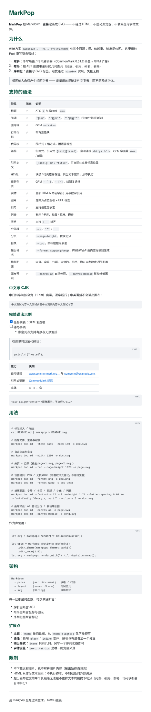
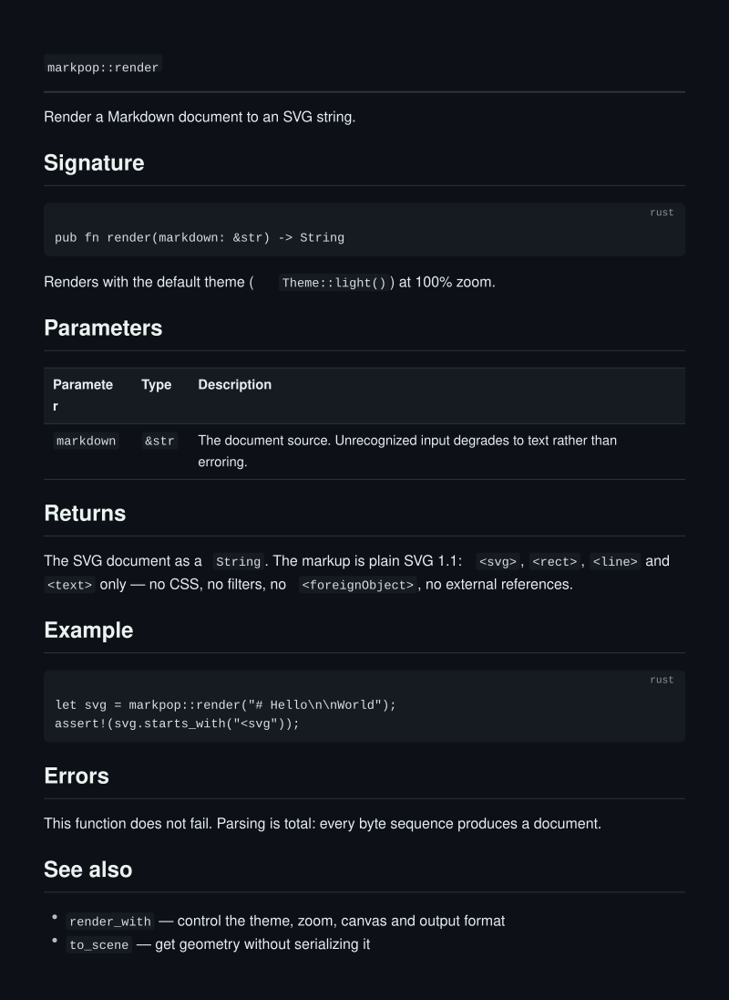
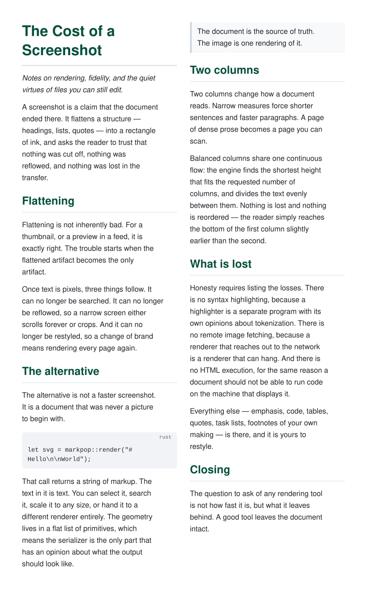
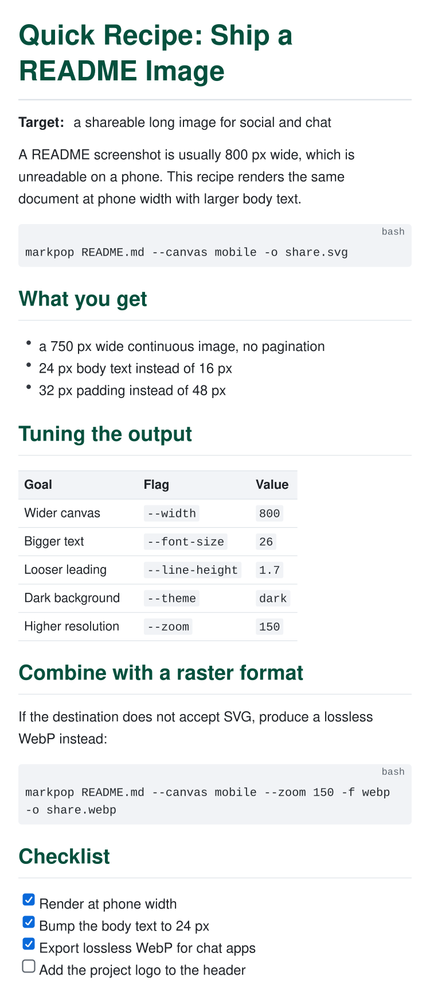
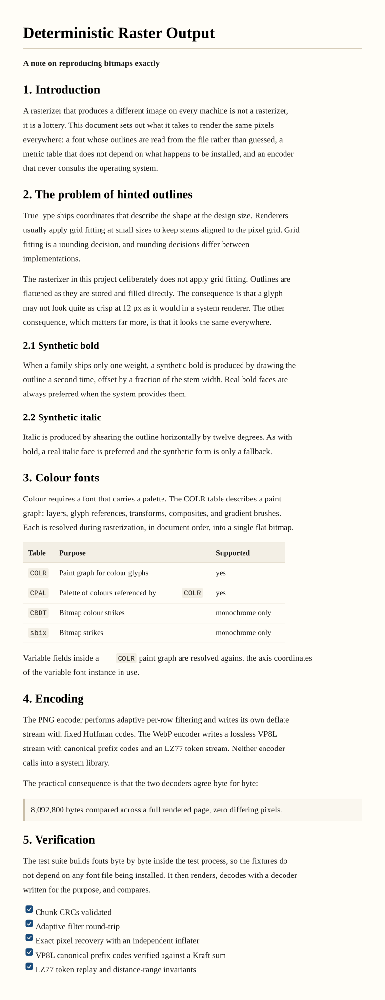

# MarkPop

**MarkPop** renders Markdown **directly to SVG, PNG or lossless WebP** — no HTML, no headless
browser, no screenshots, no image libraries. Pure Rust, zero dependencies.

```bash
cat README.md | markpop > README.svg          # vector (default)
markpop doc.md --format png  -o doc.png       # bitmap, wide compatibility
markpop doc.md --format webp -o doc.webp      # bitmap, smaller files
```



<p align="center">
  <a href="examples/dark-docs/source.md"></a>
  <a href="examples/magazine/source.md"></a>
  <a href="examples/mobile/source.md"></a>
  <a href="examples/print/source.md"></a>
  <a href="examples/zh-magazine/source.md"></a>
</p>

<p align="center"><sub>More use cases in <a href="examples/">examples/</a> — every image is rendered by the crate itself.</sub></p>

## Why

The usual pipeline is `Markdown → HTML → headless Chrome → screenshot`. It is slow, heavy and
produces a raster image you cannot restyle. This crate replaces it with a single-pass native
pipeline plus a pluggable output engine:

```
Markdown text
  → parse      (src/parse)   → Document  (src/ast.rs)
  → layout     (src/layout)  → Scene     (src/scene.rs)
  → engine     (src/engine)  → SVG | PNG | WebP
```

Consequences:

- **Three engines, one layout.** SVG is serialized directly; PNG and WebP are produced by a
  built-in software rasterizer (TrueType parser + anti-aliased scanline filler) and our own
  deflate/VP8L encoders. No browser, no system APIs, no C libraries.
- **Fast and tiny.** One binary, zero dependencies, no JS runtime.
- **Vector by default.** Text stays text — selectable, searchable, crisp at any zoom.
- **Deterministic.** Same input ⇒ same bytes, on every platform. Layout advances come from a
  built-in table instead of a system font, so a document cannot reflow because of a missing font
  (and CJK is exact: one em per glyph).
- **Self-contained.** Remote images are never fetched; they render as labeled placeholders.
- **Complete Markdown.** CommonMark 0.31.2 in full (all 652 specification examples) plus the
  GitHub Flavored Markdown extensions (tables, strikethrough, autolink literals, task lists).
  Raw HTML is rendered by its meaning (spec-bounded: blocks, structure and inline styles) and
  never executed.

## Output formats

| Format | Engine | Use when |
|---|---|---|
| `svg` (default) | `SvgEngine` — direct serializer | You want vectors: crisp at any zoom, selectable text, tiny files |
| `png` | `BitmapEngine` + PNG encoder | You need the widest compatibility (docs, chat, office tools) |
| `webp` | `BitmapEngine` + VP8L lossless encoder | You need a bitmap with the smallest size |

Bitmap engines parse a TrueType font at runtime (discovered from the system, or supplied with
`--font <FILE>`); SVG needs no font because the viewer resolves the family stack. For the
sample document, WebP lossless is ~38% smaller than the equivalent PNG, and both decode to
pixel-identical images.

The `Engine` trait (`src/engine.rs`) is the extension point: a new format only needs a
serializer over `Scene`, or an encoder over the raster `Bitmap`.

## Install

```bash
cargo install --path .
```

## CLI

```
USAGE:
    markpop [OPTIONS] [INPUT]

ARGS:
    <INPUT>    Markdown file to render. Omit or use `-` to read stdin.

OPTIONS:
    -o, --output <FILE>       Write the output to FILE instead of stdout
    -f, --format <NAME>       Output format: svg (default), png or webp
    -z, --zoom <PERCENT>      Output scale as a percentage (default: 100)
        --theme <NAME>        Color theme: light (default), dark or print
        --canvas <NAME>       Canvas: web (default), a4, a4-large or mobile
        --width <PX>          Canvas width in pixels (default: 800)
        --font-size <PX>      Base font size in pixels (default: 16)
        --line-height <MULT>  Line height multiplier (default: 1.6)
        --letter-spacing <EM> Extra tracking in em units (default: 0)
        --font-family <STACK> Font stack for body text (default: system sans)
        --mono-family <STACK> Font stack for code (default: system mono)
        --columns <N>         Text columns per page (default: 1)
        --column-gap <PX>     Gap between columns (default: 24)
        --page-height <PX>    Split into pages of this height; writes one
                              file per page (requires --output)
        --font <FILE>         TrueType font used for png/webp output
        --variation <TAG=VAL> Variable-font axis, e.g. wght=700 (repeatable)
        --toc                 Prepend a table of contents
    -h, --help                Print this help
    -V, --version             Print version information
```

Examples:

```bash
markpop doc.md -o doc.svg
markpop doc.md --canvas a4 -o page.svg                          # A4, auto-paginated
markpop doc.md --canvas mobile -o long.svg                     # 750px long image
markpop doc.md --theme print --page-height 1123 -o page.svg   # page-1.svg, page-2.svg, …
markpop doc.md --format webp --font myfont.ttf -o doc.webp
markpop doc.md --font SegUIVar.ttf --variation wght=700 -o doc.png   # bold instance
markpop doc.md --columns 2 --column-gap 28 -o doc.svg          # balanced columns
markpop doc.md --columns 3 --page-height 1123 -o page.svg      # 3 columns per page
markpop doc.md --font-size 17 --line-height 1.75 --letter-spacing 0.01 \
    --font-family "Georgia, serif" -o doc.svg
cat doc.md | markpop --theme dark --zoom 150 > doc.svg
```

## Canvas presets

| Preset | Size (base units) | Padding | Pagination |
|---|---|---|---|
| `web` (default) | 800 × auto | 48 | continuous long image |
| `a4` | 794 × 1123 (210 × 297 mm @ 96 dpi) | 56 | automatic, one file per page |
| `a4-large` | 1191 × 1684 (1.5×) | 84 | automatic, one file per page |
| `mobile` | 750 × auto, 24 px body | 32 | continuous long image |

```bash
markpop doc.md --canvas a4 -o page.svg      # → page-1.svg, page-2.svg, …
markpop doc.md --canvas a4 --format png -o page.png   # → page-1.png, …
markpop doc.md --canvas mobile -o long.svg  # one tall image for phone reading
```

```rust
use markpop::{CanvasPreset, Options};

let opts = Options::default().with_canvas(CanvasPreset::A4);
assert_eq!(opts.page_height, Some(1123.0));
```

A preset is applied first; explicit flags still win (`--canvas a4 --width 900`
keeps A4 pagination but a 900 px canvas).

### No clipping on paginated canvases

Before layout, blocks that are taller than the available space are split so
page cuts never truncate content:

- **code blocks** split at source-line boundaries, repeating the language label;
- **lists** split between items, with ordered numbering continuing across pages;
- **blockquotes** split between child blocks, each piece keeping its bar;
- **tables** split between rows, repeating the header row in every piece.

Everything else is placed whole between block boundaries. The only remaining
case is a single paragraph or figure taller than one page (thousands of
characters in one paragraph), which cannot be cut without re-flowing text.

## Typography configuration

The layout engine is driven entirely by configuration; nothing is hard-coded.

| Knob | CLI | API (`Theme`) | Default |
|---|---|---|---|
| Font size | `--font-size 18` | `with_font_size(18.0)` | 16 |
| Line height | `--line-height 1.8` | `with_line_height(1.8)` | 1.6 |
| Letter spacing | `--letter-spacing 0.02` | `with_letter_spacing(0.02)` | 0 |
| Font family | `--font-family "Georgia, serif"` | `with_font_family("Georgia, serif")` | system sans |
| Code font | `--mono-family "Consolas, monospace"` | `with_mono_family(...)` | system mono |
| Columns | `--columns 2` | `with_columns(2)` | 1 |
| Column gap | `--column-gap 28` | `with_column_gap(28.0)` | 24 |
| Variable axis | `--variation wght=700` | `with_variation("wght", 700.0)` | font default |

```rust
let theme = markpop::Theme::light()
    .with_font_size(17.0)
    .with_line_height(1.75)
    .with_letter_spacing(0.01)
    .with_font_family("Georgia, 'Times New Roman', serif")
    .with_columns(2);
let svg = markpop::render_with("# Hi", &markpop::Options::default().with_theme(theme))?;
```

Notes:

- Layout is measured with the theme's own metrics, so changing these values
  changes line breaks predictably. `--font-family` is what SVG viewers resolve;
  bitmap output uses the closest discovered TrueType face (or `--font`).
- For bitmap output the family name is also used to prefer a matching face
  among the discovered fonts.
- `--variation` only affects bitmap output; SVG text is resolved by the viewer,
  so pass the font stack you want there instead.
- Columns are either **balanced** (no page height: the shortest height that fits
  the requested number of columns) or **paginated** (a page height fills each
  column; every N columns starts a new page).
- Cuts happen between blocks; headings stay with the block they introduce, and
  code blocks taller than a column are split between lines.
- A single block that cannot fit (e.g. a very wide table) is placed alone and
  is allowed to overflow, rather than overlapping its neighbour.

## Library

```rust
// Defaults: light theme, 100% zoom.
let svg: String = markpop::render("# Hello\n\nWorld");

// Custom options, including zoom (1.0 = 100%).
let opts = markpop::Options::default()
    .with_theme(markpop::Theme::dark())
    .with_zoom(1.5);
let svg = markpop::render_with("# Hi", &opts)?;

// Geometry without serialization: useful for tests or other output formats.
let scene = markpop::to_scene("# Hi", &markpop::Theme::light());
assert!(scene.find_text("Hi").is_some());

// Bitmap engines: PNG or lossless WebP, from the same layout.
use markpop::OutputFormat;
let opts = markpop::Options::default().with_format(OutputFormat::Webp);
let bytes: Vec<u8> = markpop::render_bytes("# Hi", &opts)?;

// Long documents: pagination + table of contents.
let opts = markpop::Options::default()
    .with_page_height(1123.0)
    .with_toc(true);
let pages: Vec<String> = markpop::render_pages("# One\n\nBody", &opts)?;
```

### Zoom

Zoom is implemented with the SVG `viewBox`: geometry is written in base units and only the root
`width`/`height` scale. Nothing is re-laid-out, so 25% and 400% are pixel-identical after scaling
and the output stays vector-crisp.

```rust
use markpop::{Color, Options, Theme};

let branding = Theme { link: "#ff5500".parse()?, ..Theme::light() };
let opts = Options::default().with_theme(branding).with_zoom(1.5);
```

### Themes

Three presets ship built in, and every visual constant is a field on `Theme`:

| Preset | Character |
|---|---|
| `Theme::light()` | Sans-serif, green headings, blue links (default) |
| `Theme::dark()` | Dark canvas, soft syntax colors |
| `Theme::print()` | Serif body, warm paper, loose leading, subtle tracking |

```rust
let print = markpop::Theme {
    line_height: 1.9,
    letter_spacing: 0.01,
    ..markpop::Theme::print()
};
```

Geometry is theme-independent: changing colors never moves text. Metrics (font size, line
height, tracking) are part of the theme, so a design change re-flows predictably.

### Long documents

`--page-height` (or `Options::page_height`) splits the layout into fixed-height pages:

- cuts only ever happen **between top-level blocks** — paragraphs, tables and code boxes are
  never sliced in half;
- code blocks taller than a page are split **between lines**, repeating the language label;
- headings are kept with the block they introduce (no stranded headings at a page foot);
- pages are written as `name-1.svg`, `name-2.svg`, … and each one is a self-contained SVG.

Limitation: a non-code block taller than a page (e.g. a 100-row table) is placed alone on its
page and may overflow. Split such tables in the source or raise `--page-height`.

`--toc` prepends a nested outline of the document's h1–h3 headings.


## Supported syntax

| Construct | Notes |
|---|---|
| Headings | ATX (`#`) and Setext (`===`, `---`); h1/h2 get a rule |
| Emphasis | Full CommonMark delimiter algorithm (`*em*`, `**strong**`, `***both***`, `_em_`) |
| Strikethrough | GFM `~~text~~` (one or two tildes) |
| Inline code | Background chip, monospace, backtick runs of any length |
| Code blocks | Fenced (with language label, any info string) and indented; wrapped |
| Links | Inline `[text](url "title")`, reference `[text][label]` / collapsed / shortcut |
| Link definitions | `[label]: url "title"` anywhere in the document, matched case-insensitively |
| Autolinks | `<https://…>`, `<user@host>`, plus GFM literals (`www.`, `http://`, bare emails) |
| Images | Inline and reference images, rendered as a placeholder figure with the URL |
| Raw HTML | Block and inline HTML per the spec, rendered by meaning — structure (tables, lists, blockquotes, `<pre>`), inline styles (`<b>`, `<i>`, `<code>`, …), links, images; never executed |
| Blockquotes | Arbitrarily nested, lazy continuation, fences inside |
| Lists | Ordered/unordered, any start number, tight/loose, nested, lazy continuation |
| Task lists | GFM `- [ ]` / `- [x]`, drawn as real checkboxes |
| Tables | GFM pipe tables with `:---`, `:---:`, `---:`; escaped and code-span pipes |
| Thematic breaks | `---`, `***`, `___` |
| Escapes & entities | `\*` and the complete HTML5 named/numeric character reference table |
| Tabs | Four-column tab stops for indentation, preserved inside code and text |
| CJK | Full-width glyphs, per-character wrapping, mixed CJK/Latin |
| Pagination | Opt-in fixed-height pages, block-aligned cuts |
| Table of contents | Opt-in nested outline from headings |

Not supported (by design): remote image fetching, executing HTML (including scripts and
styles), CSS and `style` attributes, and syntax highlighting. Unrecognized input degrades to
text rather than erroring — parsing is total.

### Fitting and overflow

- **Text** wraps against measured advances; unbreakable tokens (long URLs, identifiers) are
  split by character rather than allowed to escape the canvas; CJK wraps per character.
- **Code** wraps with preformatted rules, so leading indentation and column alignment survive.
- **Tables** start at their natural width and shrink proportionally above a per-column minimum,
  guaranteeing `sum(columns) <= content width` for any column count.
- Wrapping keeps a 2% safety margin. Measured against Chromium, Latin runs render at
  0.976–1.001× the predicted advance (mean 0.978), so the margin errs on the safe side only.

## Architecture

Every stage is a pure function with its own tests:

| Stage | Input → Output | Tested by asserting on |
|---|---|---|
| `parse` | `&str` → `Document` | AST shape |
| `outline` | `Document` → `Document` | TOC nesting |
| `layout` | `Document` + `Theme` → `Scene` | primitives and coordinates |
| `paginate` | `Scene` + block marks → `Vec<Scene>` | pages, no block cuts |
| `svg` | `Scene` + zoom → `String` | markup |
| `raster` | `Scene` + fonts + zoom → `Bitmap` | pixels, glyph ink, clipping |
| `encode` | `Bitmap` → PNG / WebP bytes | headers, CRCs, pixel round-trip |
| `engine` | `Scene` → bytes | format dispatch |

```
src/
  ast.rs          document model (blocks, inlines) + flattening helpers
  parse/
    mod.rs        entry point, dialect selection, line normalization
    block.rs      containers, HTML blocks, definitions, GFM tables/tasks
    inline.rs     delimiter algorithm, links, autolinks, entities, code spans
    entities.rs   generated HTML5 character reference table
  text.rs         deterministic advance table + greedy line breaking
  html.rs         raw HTML → node tree/token stream (spec-bounded)
  layout.rs       flow engine: margins, atoms, wrapping, decorations
    layout/
      html.rs     raw HTML blocks/inlines → AST nodes for rendering
  columns.rs      multi-column flow (balanced or paginated)
  split.rs        splits oversized blocks (code/lists/quotes/tables)
  canvas.rs       canvas presets: web, A4, A4-large, mobile
  paginate.rs     block-aligned page splitting + code chunking
  outline.rs      headings → table of contents
  scene.rs        geometry primitives (text/rect/line) + Scene
  svg.rs          XML serialization, escaping, zoom
  engine.rs       Engine trait + SvgEngine / BitmapEngine factory
  font.rs         TrueType reader: cmap, loca/glyf, composite glyphs
  raster.rs       anti-aliased scanline filler + glyph compositing
  encode/
    deflate.rs    LZ77 + fixed-Huffman deflate, zlib, CRC/Adler
    png.rs        adaptive filtering + chunk writer
    webp.rs       VP8L: Huffman codes, LZ77 tokens, RIFF container
  theme.rs        all visual constants, as plain data
  options.rs      zoom, format, pagination, TOC, validation, errors
```

### Extending

- **New look** — `Theme` is plain data: start from `light()`/`dark()`/`print()` and override.
- **New syntax** — add a variant to `ast::Block`/`ast::Inline`, emit it from `parse`, and handle
  it in `layout`. Both matches are exhaustive, so the compiler lists the work.
- **New output format** — implement `engine::Engine`; it only needs `Scene` (vector) or
  `raster::Bitmap` (bitmap).
- **Better metrics** — `text::Metrics` is the only place that decides how wide a character is.

## Testing

```bash
cargo test                 # unit, integration, golden and doctests
cargo clippy --all-targets
cargo llvm-cov --summary-only
```

The suite covers each stage in isolation (parser fixtures, layout coordinates, serializer markup,
font parsing, rasterizer pixels, encoder containers) plus end-to-end properties:

- SVG well-formedness (also validated with an external XML parser)
- zoom invariance of geometry, byte-for-byte determinism (golden file)
- no-overflow guarantees for CJK, emoji, deep nesting and unbreakable tokens
- pagination: fixed page heights, whole-block placement, no stranded headings, no lost code lines
- PNG: chunk CRCs, adaptive-filter round-trip, exact pixel recovery (own inflater)
- WebP: RIFF/VP8L headers, canonical prefix codes, full-tree Kraft check, LZ77 token replay,
  distance-range invariants, and a built-in VP8L decoder that round-trips a full rendered page
- gradients: axis projection through the rotation point, radial two-circle solving,
  sweep angles (including reversed spans), pad/repeat/reflect extend modes, linear-light stops
- COLR v1: paint graph parsing (layers, glyphs, transforms, composites, sweeps), clip boxes
  and variable-field deltas, exercised with fonts built byte-by-byte inside the tests
- composite modes: every Porter-Duff and blend mode, plus an XOR composite that really
  punches a hole in the rendered bitmap
- variable fonts: tuple scalars, IUP interpolation, `avar` segment maps, axis clamping, and
  gvar/HVAR interpolation against a system variable face
- PNG vs WebP decode to **pixel-identical** images (verified in Chromium: 8,092,800 bytes
  compared, 0 differences)
- 300 pseudo-random inputs that must never panic or emit broken markup
- Markdown conformance: every one of the **652 CommonMark 0.31.2 examples** and all **24 GFM
  extension examples** parse to the structure the specifications prescribe (see below)
- task lists draw real checkboxes, autolink literals become links, HTML renders as markup

Current coverage: **94% of lines** across 483 tests (`cargo llvm-cov`), including the two
specification corpora.

## Markdown conformance

`tests/commonmark.rs` and `tests/gfm.rs` replay the official example corpora: each Markdown
snippet is parsed, serialized back to HTML by a test-only serializer, and compared with the
HTML the specification expects. Per-section floors fail the build on any regression.

| Corpus | Examples | Passing |
|---|---|---|
| CommonMark 0.31.2 | 652 | 652 (100%) |
| GFM 0.29 extensions | 24 | 24 (100%) |

The GFM dialect is the default. Strict CommonMark is available as `parse::parse_commonmark`
(no autolink literals, no task lists), and `parse::parse_with` takes an `Extensions` value
for anything in between.

Two deliberate differences from an HTML renderer: raw HTML is rendered by its meaning within
the Markdown spec's boundary — no CSS, no scripts, unknown tags act as transparent containers
— and images become labelled placeholders instead of remote fetches. Nothing is ever executed.

## SVG compatibility

The output is deliberately plain SVG 1.1: `<svg>`, `<rect>`, `<line>` and `<text>` only — no CSS,
no filters, no `<foreignObject>`, no external references. Text is real text (selectable and
searchable), decimals are rounded to two places, and every text node is XML-escaped.

It renders directly in browsers (verified in Chromium), can be embedded with ``, and
converts cleanly to PNG/PDF with the usual tooling. All generated files (samples, golden fixture,
paginated pages) parse with an independent XML parser, and a real-browser measurement of every
text run in `examples/showcase/showcase.svg` put the widest right edge at 739.8px inside the
752px content column.

Underlines and strikethroughs are drawn as explicit `<line>` primitives instead of
`text-decoration`, so every renderer places them identically.

```bash
# Rasterize with a browser, if you need a PNG from SVG:
msedge --headless --screenshot=out.png --window-size=800,1200 out.svg
```

## Raster output notes

- PNG uses truecolor+alpha with adaptive per-row filters and our own fixed-Huffman deflate.
- WebP is **lossless** (VP8L): literal + LZ77 tokens, length-limited canonical Huffman codes,
  no transforms and no color cache (the simplest valid encoder).
- Both come from the same inline rasterizer, so their decoders agree byte for byte.

### Font fidelity

The rasterizer follows the font's own design rather than approximating it:

- **Unhinted outlines** are flattened and filled directly; no grid fitting distorts the shapes.
- **Real bold and italic faces** are used when the system provides them (`segoeuib.ttf`,
  `consolai.ttf`, …). Faux bold (a sub-pixel second pass) and faux italic (a shear) are only
  fallbacks for families that ship a single style.
- **Colour emoji** follow the font's own `COLR` paint graph and `CPAL` palette: layers,
  affine transforms, solid fills, linear, radial and sweep gradients, clip boxes and all 28
  composite/blend modes are taken from the font's geometry and mode numbers. COLR v1 is
  preferred, with the v0 layer list as a fallback for older fonts. No tinting or
  re-colouring is synthesised. Gradient interpolation and blending happen in linear light
  with premultiplied alpha, as the specification requires.
- **Variable fonts** interpolate: `fvar`/`avar` axes are normalized, `gvar` moves outline
  points (with IUP interpolation for points the font leaves implicit, and component offsets
  for composites), and `HVAR` updates advances. COLR variation deltas (`PaintVar*`, variable
  clip boxes, colour lines) are read through the item variation store, so colour glyphs
  follow the selected instance too.
- Glyphs are positioned with the font's own advances, like a browser does for SVG; line
  breaking uses the deterministic metric table so output stays stable.

Bitmap output needs a TrueType font. Discovery covers common Windows/macOS/Linux locations;
pass `--font <FILE>` to pin one, and `--variation TAG=VALUE` (repeatable) to pick a variable
instance. Colour requires a COLR-based font (Segoe UI Emoji, Noto COLR builds, …);
bitmap-only colour formats (`CBDT`, `sbix`) render monochrome.

## Examples

[`examples/`](examples/) holds one directory per use case. Each contains the Markdown
source and the files MarkPop renders from it, and every image is reproducible with
`examples/render.sh`:

| Use case | Flags | Output |
|---|---|---|
| [Feature showcase](examples/showcase/source.md) | — | `showcase.{svg,png,webp}` |
| [Blog post](examples/blog-post/source.md) | — | `blog-post.{svg,png,webp}` |
| [Operations handbook](examples/handbook/source.md) | `--canvas a4` | `page-{1,2,3}.{svg,png,webp}` |
| [Dark documentation](examples/dark-docs/source.md) | `--theme dark` | `dark-docs.{svg,png,webp}` |
| [Print-ready paper](examples/print/source.md) | `--theme print` | `print.{svg,png,webp}` |
| [Two-column article](examples/magazine/source.md) | `--columns 2` | `magazine.{svg,png,webp}` |
| [Mobile share image](examples/mobile/source.md) | `--canvas mobile` | `mobile.{svg,png,webp}` |

Every document is rendered in all three formats. The showcase is the same document through
every engine: SVG for vectors, PNG for compatibility, and lossless WebP for the same
pixels at roughly 38% less size.

The same six use cases exist in Chinese — CJK is measured as full width (1 em per glyph)
and breaks per character, so mixed Chinese and Latin never overflows the canvas:

| 用例 | 参数 | 产物 |
|---|---|---|
| [技术博客](examples/zh-blog-post/source.md) | — | `zh-blog-post.{svg,png,webp}` |
| [值班手册](examples/zh-handbook/source.md) | `--canvas a4` | `page-{1,2,3}.{svg,png,webp}` |
| [深色文档](examples/zh-dark-docs/source.md) | `--theme dark` | `zh-dark-docs.{svg,png,webp}` |
| [打印稿](examples/zh-print/source.md) | `--theme print` | `zh-print.{svg,png,webp}` |
| [双栏排版](examples/zh-magazine/source.md) | `--columns 2` | `zh-magazine.{svg,png,webp}` |
| [移动端长图](examples/zh-mobile/source.md) | `--canvas mobile` | `zh-mobile.{svg,png,webp}` |

### Posting images to social platforms

An image is not subject to a character limit, which makes it the practical way to
publish long content from a free account:

```bash
markpop doc.md --canvas mobile -f webp -o share.webp
```

- `--canvas mobile` gives a 750 px wide long image with 24 px body text.
- `-f webp` writes a lossless WebP at roughly 60% of the PNG size, and every major
  platform accepts it. Fall back to `-f png` where WebP is not supported.
- Check the file size before uploading: X accepts up to 5 MB per image and 4 images
  per post; a full announcement long image lands well under that.

`examples/zh-announcement/` is exactly this recipe — a project announcement rendered to
a 750 × 2750 long image, in all three formats.

## License

MIT OR Apache-2.0
