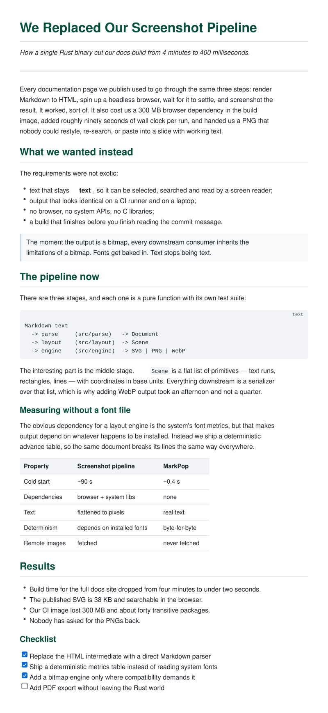
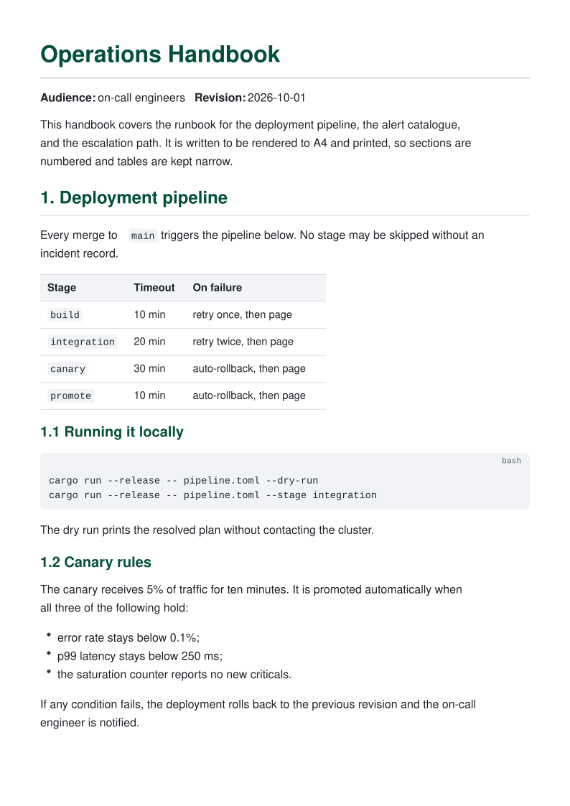
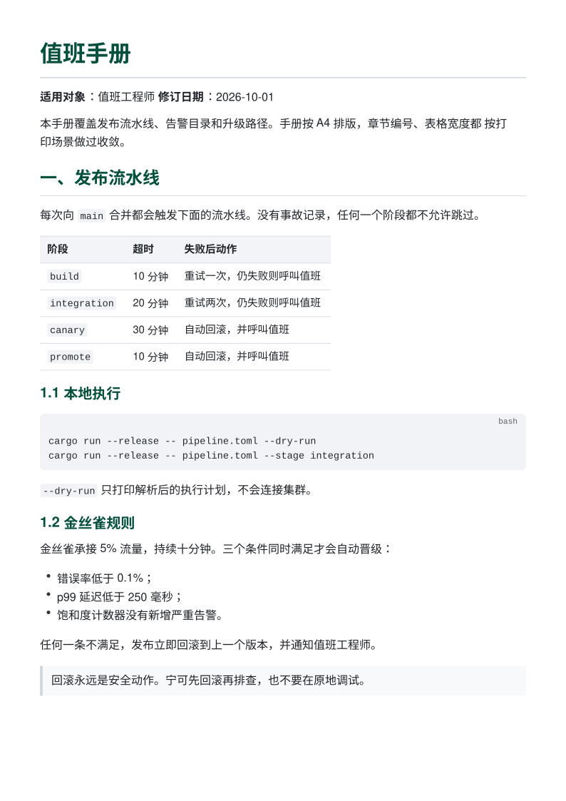
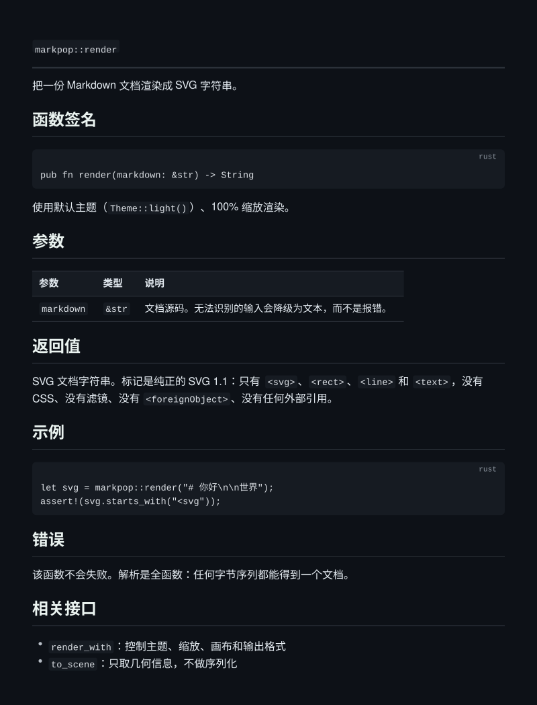
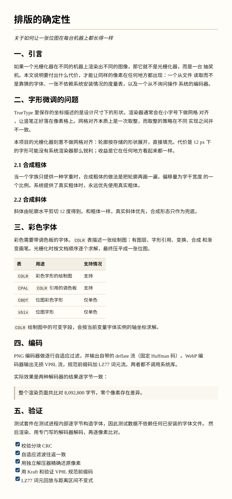
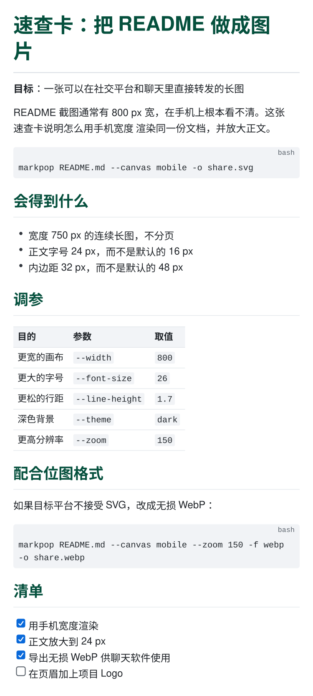

# Examples

Every image in this directory is produced by MarkPop from the `source.md` sitting next to
it. Nothing here is a screenshot of a browser — these files are the renderer talking to
itself.

Each document is rendered in all three output formats:

| Format | Engine | Use when |
|---|---|---|
| `.svg` | `SvgEngine` — direct serializer | you want vectors: crisp at any zoom, selectable text, tiny files |
| `.png` | `BitmapEngine` + PNG encoder | you need the widest compatibility (docs, chat, office tools) |
| `.webp` | `BitmapEngine` + VP8L lossless encoder | you need a bitmap with the smallest size |

Regenerate all of them with:

```bash
examples/render.sh
```

or verify that the committed output is up to date:

```bash
examples/render.sh --check
```

`--check` compares the SVG files byte for byte and confirms that every document has a PNG
and a WebP sibling. The bitmap files are not byte-compared: they are rasterized with the
fonts installed on the machine that renders them, so their bytes legitimately differ
between operating systems. Layout does not — line breaking uses the built-in metric table,
not the system font, so the page count and the line breaks are the same everywhere.

## Scenarios

### English

| Scenario | Source | Flags | Output |
|---|---|---|---|
| Feature showcase | [`showcase/source.md`](showcase/source.md) | — | `showcase.{svg,png,webp}` |
| Blog post | [`blog-post/source.md`](blog-post/source.md) | — | `blog-post.{svg,png,webp}` |
| Operations handbook | [`handbook/source.md`](handbook/source.md) | `--canvas a4` | `page-{1,2,3}.{svg,png,webp}` |
| Dark documentation | [`dark-docs/source.md`](dark-docs/source.md) | `--theme dark` | `dark-docs.{svg,png,webp}` |
| Print-ready paper | [`print/source.md`](print/source.md) | `--theme print` | `print.{svg,png,webp}` |
| Two-column article | [`magazine/source.md`](magazine/source.md) | `--columns 2` | `magazine.{svg,png,webp}` |
| Mobile share image | [`mobile/source.md`](mobile/source.md) | `--canvas mobile` | `mobile.{svg,png,webp}` |

### 中文

| 场景 | 源文件 | 参数 | 产物 |
|---|---|---|---|
| 功能总览 | [`showcase/source.md`](showcase/source.md) | — | `showcase.{svg,png,webp}` |
| 技术博客 | [`zh-blog-post/source.md`](zh-blog-post/source.md) | — | `zh-blog-post.{svg,png,webp}` |
| 值班手册 | [`zh-handbook/source.md`](zh-handbook/source.md) | `--canvas a4` | `page-{1,2,3}.{svg,png,webp}` |
| 深色文档 | [`zh-dark-docs/source.md`](zh-dark-docs/source.md) | `--theme dark` | `zh-dark-docs.{svg,png,webp}` |
| 打印稿 | [`zh-print/source.md`](zh-print/source.md) | `--theme print` | `zh-print.{svg,png,webp}` |
| 双栏排版 | [`zh-magazine/source.md`](zh-magazine/source.md) | `--columns 2` | `zh-magazine.{svg,png,webp}` |
| 移动端长图 | [`zh-mobile/source.md`](zh-mobile/source.md) | `--canvas mobile` | `zh-mobile.{svg,png,webp}` |

中文文档按全角（1 em）度量、逐字断行，中英混排不会溢出画布——下面几例都是真实
渲染结果，不是示意图。

---

## Feature showcase

The full syntax surface in one document: headings, emphasis, code, tables, task lists,
blockquotes, images, and the deliberate gaps.

```bash
markpop examples/showcase/source.md -o showcase.svg
markpop examples/showcase/source.md -f png  -o showcase.png
markpop examples/showcase/source.md -f webp -o showcase.webp
```


The two bitmap files hold the same pixels; the lossless WebP is roughly 38% smaller than
the PNG.

---

## Blog post

A technical article rendered to a continuous web canvas — the shape a blog post wants.

```bash
markpop examples/blog-post/source.md -f svg  -o blog-post.svg
markpop examples/blog-post/source.md -f png  -o blog-post.png
markpop examples/blog-post/source.md -f webp -o blog-post.webp
```



---

## Operations handbook

An A4 document that paginates automatically. Cuts land between blocks, tables repeat their
header row, and code blocks split on line boundaries.

```bash
markpop examples/handbook/source.md --canvas a4 -o page.svg
# → page-1.svg, page-2.svg, page-3.svg
markpop examples/handbook/source.md --canvas a4 -f png -o page.png
# → page-1.png, page-2.png, page-3.png
```



---

## Dark documentation

The dark theme, for docs sites that ship their own dark mode.

```bash
markpop examples/dark-docs/source.md --theme dark -f svg -o dark-docs.svg
markpop examples/dark-docs/source.md --theme dark -f png -o dark-docs.png
```


---

## Print-ready paper

Serif body, warm paper, looser leading — a theme meant for the printer.

```bash
markpop examples/print/source.md --theme print -f svg  -o print.svg
markpop examples/print/source.md --theme print -f png  -o print.png
markpop examples/print/source.md --theme print -f webp -o print.webp
```


---

## Two-column article

Balanced columns: the engine finds the shortest height that fits two columns and divides
the flow evenly.

```bash
markpop examples/magazine/source.md --columns 2 --column-gap 28 -f svg -o magazine.svg
markpop examples/magazine/source.md --columns 2 --column-gap 28 -f webp -o magazine.webp
```


---

## Mobile share image

Phone width, larger body text, no pagination.

```bash
markpop examples/mobile/source.md --canvas mobile -f svg  -o mobile.svg
markpop examples/mobile/source.md --canvas mobile -f png  -o mobile.png
markpop examples/mobile/source.md --canvas mobile -f webp -o mobile.webp
```


---

# 中文场景

以下示例的源文档都是中文，用来展示 CJK 排版：全角标点、逐字断行、中英混排。
每个场景同样输出 SVG、PNG 和无损 WebP 三种格式。

## 技术博客

```bash
markpop examples/zh-blog-post/source.md -f svg  -o zh-blog-post.svg
markpop examples/zh-blog-post/source.md -f png  -o zh-blog-post.png
markpop examples/zh-blog-post/source.md -f webp -o zh-blog-post.webp
```


## 值班手册

A4 自动分页，中文段落按字断行，表格跨页时重复表头。

```bash
markpop examples/zh-handbook/source.md --canvas a4 -f svg -o page.svg
markpop examples/zh-handbook/source.md --canvas a4 -f png -o page.png
# → page-1.svg, page-2.svg, page-3.svg
```



## 深色文档

```bash
markpop examples/zh-dark-docs/source.md --theme dark -f svg -o zh-dark-docs.svg
markpop examples/zh-dark-docs/source.md --theme dark -f png -o zh-dark-docs.png
```



## 打印稿

```bash
markpop examples/zh-print/source.md --theme print -f svg  -o zh-print.svg
markpop examples/zh-print/source.md --theme print -f png  -o zh-print.png
markpop examples/zh-print/source.md --theme print -f webp -o zh-print.webp
```



## 双栏排版

```bash
markpop examples/zh-magazine/source.md --columns 2 --column-gap 28 -f svg -o zh-magazine.svg
markpop examples/zh-magazine/source.md --columns 2 --column-gap 28 -f webp -o zh-magazine.webp
```


## 移动端长图

```bash
markpop examples/zh-mobile/source.md --canvas mobile -f svg  -o zh-mobile.svg
markpop examples/zh-mobile/source.md --canvas mobile -f png  -o zh-mobile.png
markpop examples/zh-mobile/source.md --canvas mobile -f webp -o zh-mobile.webp
```


